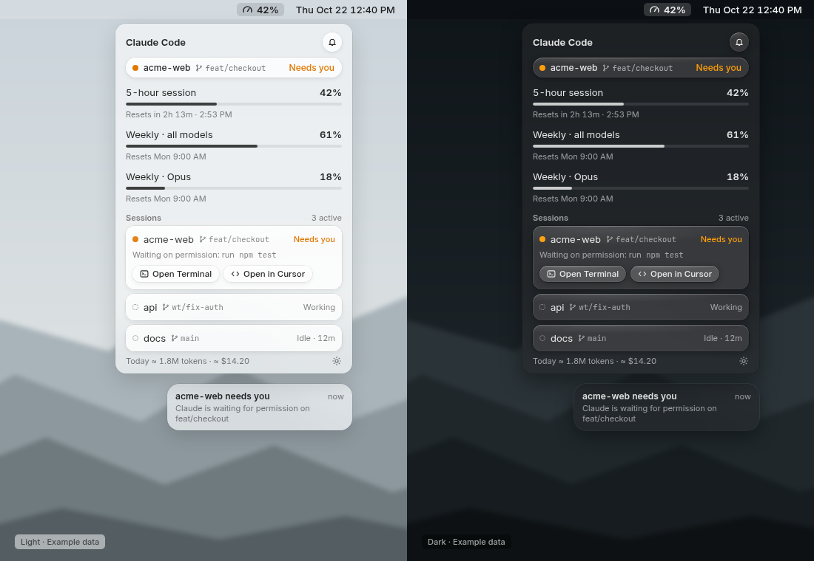

# Tidepool

A macOS 26 menu bar app for AI usage limits. This build reads **Claude Code**. Cursor, Codex, and Wispr Flow are detected and labeled **coming soon**. Grok Bot has no cited install marker, so it is not reported as installed.

The panel follows the Floating Needs-you mockup: light on the left, dark on the right, example data.



Live screenshots replace that mockup after the first signed build. The HTML for the mockup is `mockups/glass-b.html`.

Tidepool is not affiliated with Anthropic. The 5-hour block estimate follows the behavior described by [ccusage](https://github.com/ryoppippi/ccusage) (MIT). This project does not copy that code.

## Requirements

- macOS 26
- Xcode with the macOS 26 SDK. CI prints `xcodebuild -version`, then builds with Swift Package Manager. There is no Xcode project and no Makefile.

## Supported providers

Claude Code is the only provider with a usage feed. Server figures are unlabeled. Estimates are marked `est.` or ≈.

| What you see | Source | Label |
|---|---|---|
| 5-hour, weekly all-models, and weekly Opus or Sonnet percents, plus reset times | `GET https://api.anthropic.com/api/oauth/usage` with the Claude Code OAuth token and `anthropic-beta: oauth-2025-04-20` | **Real.** Server figure. The endpoint is undocumented. It is the one Claude Code's `/usage` command uses. Buckets can be null. |
| The same percents when that call fails | Status-line JSON `rate_limits.five_hour` and `rate_limits.seven_day` (`used_percentage`, `resets_at` as Unix seconds), written by the optional `cmb-hook statusline` wrapper | **Real.** Server figure relayed by Claude Code. Present for Pro and Max after the first API response. The panel says "From the status line". |
| Today's tokens and dollars, and the block burn rate in Settings | `~/.claude/projects/**/*.jsonl`, `message.usage`, deduped by message id plus request id | **Estimated.** List price from the [Claude API pricing page](https://platform.claude.com/docs/en/about-claude/pricing) as checked on 2026-10-22. Cache writes without a 5-minute / 1-hour split use the 5-minute rate. Unknown models omit the dollar amount. The footer uses ≈. |
| A 5-hour block with no server window | Floored hour of the first message, five hours long. A gap of more than five hours starts another block | **Estimated.** Anthropic's real window can differ. Rows are labeled `est.` |
| Needs you / Working / Idle, and "Waiting on permission: run …" | Notification (`permission_prompt`, `idle_prompt`, `agent_needs_input`), PermissionRequest, Stop, SessionStart, SessionEnd, and UserPromptSubmit hooks | **Real.** From Claude Code. The hook prints nothing to stdout, so it does not approve or deny the prompt. |
| The same states with `(est.)` | Last transcript role, only for sessions with no hook events | **Estimated.** An assistant message between 30 seconds and 10 minutes old is Needs you. |

Extra usage is shown only when the payload includes `extra_usage.utilization`. `used_credits` is not displayed.

The menu bar item is the template symbol `gauge.with.dots.needle.50percent` plus the 5-hour percent. It is drawn in system orange only while a session needs you. Settings can hide the percent or add the reset countdown.

Settings switches in this build are **Notifications when a session needs you**, **Launch at login**, and **Claude Code hooks**.

## Auto-detection and coming soon

On launch, Tidepool looks for install markers it can name. A detected tool with no usage feed is **coming soon** in the panel and **Detected · coming soon** in Settings.

| Tool | Counted as installed when |
|---|---|
| Claude Code | `claude` is on `PATH`, or `~/.claude` exists. This one is active, not coming soon. |
| Cursor | `Cursor.app` is in `/Applications`, `~/Applications`, or `/System/Applications`, or `cursor` is on `PATH`, or `~/Library/Application Support/Cursor` exists |
| Codex | `codex` is on `PATH`, or `~/.codex` exists, or `CODEX_HOME` names an existing directory |
| Wispr Flow | `Wispr Flow.app` is in one of those application folders |

Grok Bot's catalog entry has no signature. Settings shows **No documented on-disk marker yet**. Cursor being installed does not count as Grok Bot.

See [ROADMAP.md](ROADMAP.md) and [CONTRIBUTING.md](CONTRIBUTING.md).

## Build from source

```bash
git clone https://github.com/Jynxed-hash/Tidepool.git
cd Tidepool
git checkout main
scripts/assemble-app.sh
open dist/Tidepool.app
```

`scripts/assemble-app.sh` runs `swift build -c release --product Tidepool --product cmb-hook` and wraps the binaries. They also remain at:

- `.build/release/Tidepool`
- `.build/release/cmb-hook`

The app bundle is `dist/Tidepool.app`. `LSUIElement` is set, so it has no Dock icon. Look for the gauge in the menu bar. If the menu bar is full, check the menu bar overflow.

`swift run Tidepool` also launches it, and that process shows a Dock icon because the SwiftPM run does not use the bundle's `Info.plist`.

### Signed DMG and Homebrew

Not done in this repository yet.

1. On a Mac with a Developer ID certificate, run `scripts/build-dmg.sh`, sign the app, then `NOTARY_KEYCHAIN_PROFILE=… scripts/notarize.sh`.
2. Attach `Tidepool-<version>.dmg` to a GitHub release.
3. Fill in the real `sha256` in `Casks/tidepool.rb` and copy that cask into [Jynxed-hash/homebrew-tap](https://github.com/Jynxed-hash/homebrew-tap).

After that, the install is:

```bash
brew install --cask jynxed-hash/tap/tidepool
```

`Casks/tidepool.rb` in this repo is a template. The checksum is a placeholder, so installing it today will fail.

## Privacy

Tidepool reads credentials and does not write them back. The Claude Code token is read from the Keychain item `Claude Code-credentials` or from `~/.claude/.credentials.json`. It is held in memory and sent as `Authorization: Bearer` only to `https://api.anthropic.com/api/oauth/usage`. Tidepool does not refresh the token. If it is expired, open Claude Code once and let Claude Code refresh it.

The token is not written to `~/Library/Application Support/Tidepool`, the event log, or a status-line file. There is no analytics. Prompt text from `UserPromptSubmit` is discarded. Transcript parsing keeps usage, timestamps, cwd, git branch, role, and ids. A permission hook keeps the tool name and a short command or path, not the conversation.

## Testing

Unit tests, from the repo root:

```bash
swift test
```

They cover usage JSON, status-line JSON, transcript dedupe, block boundaries, list prices, hook ingestion, the settings installer, and install detection. They do not call Anthropic. GitHub Actions on `macos-26` runs `swift test` and `swift build -c release --product Tidepool --product cmb-hook`.

### Launch

```bash
scripts/assemble-app.sh
open dist/Tidepool.app
```

Click the gauge. The gear opens Settings.

### Install the Claude Code hooks

In Settings, turn on **Claude Code hooks**. That copies `cmb-hook` to `~/Library/Application Support/Tidepool/cmb-hook`, writes a byte-for-byte backup of `~/.claude/settings.json` under `~/.claude/tidepool-backups/`, and merges hook entries. Running it again does not duplicate them. Turning the switch off removes only Tidepool's entries and restores a status line Tidepool replaced.

Confirm the install:

```bash
grep -n cmb-hook ~/.claude/settings.json
ls -l ~/Library/Application\ Support/Tidepool/cmb-hook
```

The command in `settings.json` contains `/Tidepool/cmb-hook`. Notification hooks use the matcher `permission_prompt|idle_prompt|agent_needs_input`. PermissionRequest, Stop, SessionStart, SessionEnd, and UserPromptSubmit are installed too.

### Trigger Needs you

1. Leave **Claude Code hooks** on, and leave notifications on if you want the macOS banner.
2. Start Claude Code in a repository.
3. Ask it to run a shell command that is not auto-allowed, and leave the permission prompt unanswered.

Within a few seconds the menu bar gauge turns orange and the panel shows that repo as **Needs you**, with the waiting line from the hook (a short command or path, not the prompt). `PermissionRequest` and a `permission_prompt` notification are the events that set that state. `idle_prompt` and `agent_needs_input` do the same.

Without hooks, the same row can appear from the transcript heuristic and is labeled **Needs you (est.)**.

### Logs

Tidepool does not write an `os_log`. The debug trail is the support folder:

```bash
tail -f ~/Library/Application\ Support/Tidepool/events.ndjson
```

A Needs you event is a JSON line whose `hook` is `PermissionRequest`, or `Notification` with `notificationType` `permission_prompt`, `idle_prompt`, or `agent_needs_input`. `cmb-hook` writes that file and prints nothing to stdout, so an empty hook stdout is expected.

`~/Library/Application Support/Tidepool/statusline.json` is the last status-line snapshot, when the status-line wrapper is installed. Override the support folder with `TIDEPOOL_SUPPORT_DIR` if you want a scratch directory.

To watch the app process itself, quit the bundle and run the executable in Terminal:

```bash
dist/Tidepool.app/Contents/MacOS/Tidepool
```

Codex usage is not in this build. A detected Codex install shows as coming soon and has no usage numbers to check.

## License

MIT. See [LICENSE](LICENSE).
